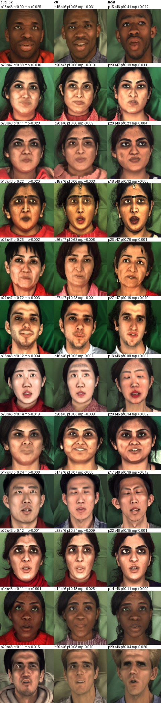

# Low-end-data retrain: results (October 29, 2026)

Results of the design pre-registered in [2026-10-29 low-end retrain design](2026-10-29-low-end-retrain-design.md). That entry defines the arms, the readings and their thresholds. The thresholds were not changed after the results.

## Runs

- **Training.** Control job 750647 (2 h 04) and treatment job 750648 (1 h 59) both completed 25k steps. The LR reached 0 at step 25k. Each arm wrote 10 main and 10 EMA checkpoints, every 2.5k steps.
- **Evaluation.** Ten `batch_eval` jobs (750904–751257), all completed:
  - EMA 10k / 15k / 20k / 25k of both arms on the original units;
  - EMA 25k of both arms on the held-out units.
- **Record counts** match the earlier runs: 330 / 120 / 90 (original units) and 660 / 120 / 180 (held-out) for `calibration_jitter` / `scaled` / `permuted`.
- **Analysis.** `lowend_analysis.py` holds the pre-registered readings. `lowend_followup.py` holds the follow-ups marked *not pre-registered* below, and `lowend_sheet.py` builds the contact sheets.
  - These scripts, their printed output and the eval submitter are in `inference_output/batch_eval/heldout/lowend_analysis/`.
  - The report is `inference_output/batch_eval/heldout/lowend_report.json`.
- **Statistics.** All Δ are paired with a 2,000-draw bootstrap over (prompt, seed) units.
  - "Fail" means a ramp with AU12 r < 0.5.
  - "Frame 0" is the detected level of the ramp's first (c = 0) frame.
  - "c ≤ 0.1" is the mean detected level of constant (dithered) sequences at c = 0 and 0.1.

## Primary: treatment − control, EMA-25k, held-out units

| protocol | metric | control | treatment | Δ [95% CI] |
|---|---|---|---|---|
| calibration_jitter (60 units) | CLS MediaPipe | 0.324 | 0.475 | **+0.151 [+0.102, +0.200]** |
| | CLS py-feat | 0.482 | 0.624 | +0.142 [+0.085, +0.197] |
| | c ≤ 0.1 MediaPipe | −0.000 | −0.003 | **−0.003 [−0.006, −0.000]** |
| | c ≤ 0.1 py-feat | 0.331 | 0.331 | −0.001 [−0.044, +0.043] |
| scaled (120 units) | frame 0 MediaPipe | −0.005 | −0.009 | **−0.004 [−0.006, −0.002]** |
| | frame 0 py-feat | 0.437 | 0.277 | −0.160 [−0.205, −0.115] |
| | ramp MediaPipe r | 0.766 | 0.842 | **+0.076 [+0.043, +0.111]** |
| | ramp AU12 r | 0.682 | 0.810 | +0.128 [+0.075, +0.179] |
| | fail | 15.8% | 6.7% | −9.2 pt [−15.9, −2.5] |
| | id min-adjacent | 0.894 | 0.879 | −0.015 [−0.028, −0.003] |
| permuted (60 units) | AU12 r | 0.527 | 0.665 | **+0.138 [+0.078, +0.198]** |
| | MediaPipe r | 0.601 | 0.733 | **+0.133 [+0.078, +0.194]** |
| | id min-adjacent | 0.876 | 0.875 | −0.002 [−0.015, +0.012] |

**Readings:**

1. **Low end: holds.** MediaPipe frame 0 and c ≤ 0.1 are both lower for the treatment, and both CIs exclude 0. The effects are small in absolute terms: MediaPipe spans only 0.02–0.03 from c = 0 to c = 1 (table below), so −0.004 is roughly 13–21% of that range. What they consist of is analysed in the next section.
2. **Calibration: holds.** The CLS MediaPipe Δ lower bound is +0.102, against a threshold of −0.05.
3. **Ramps: holds.** Ramp MediaPipe r Δ is +0.076, against a threshold of −0.05.
4. **Non-monotonic following: holds.** Permuted r Δ is +0.138 (AU12) and +0.133 (MediaPipe).
5. **Failure tail and identity (reported).** The fail rate drops from 15.8% to 6.7%. Worst-case adjacent identity on ramps is 0.015 lower; on permuted lists it is unchanged.

**Decision rule (from the design):** readings 1–4 hold, so the treatment recipe becomes the main model. It replaces both the original 25k (ramps) and aug 15k (calibration) in reporting. The comparison with those two models below supports this.

## What the low-end gain consists of (not pre-registered)

Mean detected level by commanded level, `calibration_jitter`, held-out units. FineFace\* is on the original units with the plain calibration protocol, so it is unpaired.

| py-feat AU12 | 0.0 | 0.1 | 0.2 | 0.3 | 0.4 | 0.5 | 0.6 | 0.7 | 0.8 | 0.9 | 1.0 | 1.0 − 0.0 |
|---|---|---|---|---|---|---|---|---|---|---|---|---|
| original 25k | 0.426 | 0.355 | 0.406 | 0.462 | 0.528 | 0.635 | 0.740 | 0.772 | 0.771 | 0.809 | 0.819 | 0.393 |
| aug 15k | 0.254 | 0.238 | 0.368 | 0.444 | 0.502 | 0.603 | 0.673 | 0.710 | 0.754 | 0.786 | 0.800 | 0.546 |
| control | 0.420 | 0.243 | 0.370 | 0.412 | 0.463 | 0.476 | 0.503 | 0.529 | 0.613 | 0.708 | 0.806 | 0.386 |
| treatment | 0.320 | 0.342 | 0.357 | 0.413 | 0.452 | 0.489 | 0.567 | 0.641 | 0.722 | 0.815 | 0.868 | 0.548 |
| FineFace\* | 0.054 | 0.067 | 0.085 | 0.142 | 0.159 | 0.224 | 0.268 | 0.326 | 0.390 | 0.468 | 0.573 | 0.518 |

| MediaPipe | 0.0 | 0.1 | 0.2 | 0.3 | 0.4 | 0.5 | 0.6 | 0.7 | 0.8 | 0.9 | 1.0 | 1.0 − 0.0 |
|---|---|---|---|---|---|---|---|---|---|---|---|---|
| original 25k | +0.003 | −0.003 | +0.001 | 0.004 | 0.007 | 0.011 | 0.015 | 0.017 | 0.019 | 0.020 | 0.021 | 0.018 |
| aug 15k | −0.005 | −0.004 | +0.001 | 0.004 | 0.005 | 0.009 | 0.012 | 0.014 | 0.018 | 0.020 | 0.023 | 0.028 |
| control | +0.004 | −0.005 | +0.000 | 0.002 | 0.002 | 0.004 | 0.006 | 0.009 | 0.011 | 0.016 | 0.022 | 0.019 |
| treatment | −0.003 | −0.004 | −0.002 | 0.000 | 0.003 | 0.004 | 0.008 | 0.011 | 0.015 | 0.020 | 0.027 | 0.030 |
| FineFace\* | +0.001 | +0.002 | +0.003 | 0.006 | 0.008 | 0.012 | 0.015 | 0.017 | 0.019 | 0.022 | 0.026 | 0.026 |

1. **The treatment removes the c = 0 bump** of the raw-label models.
   - In the control and the original 25k, c = 0 reads *higher* than c = 0.1 on both detectors (py-feat 0.42 vs 0.24, MediaPipe +0.004 vs −0.005).
   - The treatment's py-feat curve is monotone over all 11 levels, and it has the widest 0 → 1 range on both detectors.
   - Most of the c ≤ 0.1 MediaPipe Δ of reading 1 is this bump. The ramp's first frame also drops, by −0.16 py-feat and −0.004 MediaPipe.
2. **MediaPipe is at a floor at the low end.** Apart from the c = 0 bump, every model of ours reads between −0.005 and +0.001 for c ≤ 0.2. Below that floor MediaPipe cannot tell whether a face is "more neutral".
3. **Against aug 15k the constant low end is not better.** On c ≤ 0.1, py-feat reads 0.331 vs 0.246 (Δ +0.085 [+0.045, +0.124]), and MediaPipe is equal. The ramp's first frame is lower (py-feat −0.077 [−0.126, −0.030]). See the next section.
4. **The treatment's c = 0 sits at the py-feat level of real neutral faces.**
   - Real MEAD neutral training frames read py-feat mean 0.32 / median 0.27 ([2026-10-29 neutral clips](2026-10-29-mead-neutral-clips-label-bias.md)). The treatment reads 0.32 at constant c = 0 and 0.28 at ramp frame 0.
   - FineFace's 0.05 (constant) / 0.16 (frame 0) is *below* MEAD's real neutral faces.
   - MediaPipe ranks the other way: FineFace +0.001 at c = 0 and +0.009 at frame 0, against the treatment's −0.003 and −0.009.
   - So the absolute low end differs between generators in a detector-dependent way, as py-feat's skin-tone offset already showed on real faces. Interpretation, since neither detector is ground truth: the remaining py-feat gap to FineFace is not by itself evidence that our c = 0 smiles. Only paired comparisons within a generator are firm.
5. **Visual check.** See  (`calibration_jitter` at level 0, frame 0; columns aug 15k / control / treatment; seeded random draw).
   - At this resolution the control shows a visible smile in 2 of 12 draws (p15 s46 and p20 s45, with teeth showing).
   - None of the treatment's 12 frames clearly smiles.
   - Open, speech-like mouths are common in all three models; MEAD clips are speech. The treatment's p26 s47 reads py-feat 0.76 on such a mouth without a visible smile.
   - A 6-unit ramp sheet (`lowend_ramps.jpg`, next to the scripts) shows neutral → smile ramps in all three models.

## Treatment vs the current reporting models, held-out (not pre-registered)

The design lists neither comparison. Treatment vs original 25k was coded into the analysis before the results came in. Treatment vs aug 15k was added after them, because the decision rule says the treatment replaces both models.

| metric | original 25k | aug 15k | treatment | treatment − original 25k | treatment − aug 15k |
|---|---|---|---|---|---|
| CLS MediaPipe | 0.383 | 0.447 | 0.475 | +0.092 [+0.026, +0.167] | +0.028 [−0.031, +0.083] |
| CLS py-feat | 0.560 | 0.626 | 0.624 | +0.064 [−0.001, +0.133] | −0.003 [−0.053, +0.045] |
| c ≤ 0.1 py-feat | 0.390 | 0.246 | 0.331 | −0.059 [−0.120, −0.003] | +0.085 [+0.045, +0.124] |
| c ≤ 0.1 MediaPipe | 0.000 | −0.004 | −0.003 | −0.004 [−0.007, −0.001] | +0.001 [−0.002, +0.003] |
| frame 0 py-feat | 0.243 | 0.354 | 0.277 | +0.034 [−0.007, +0.074] | −0.077 [−0.126, −0.030] |
| frame 0 MediaPipe | −0.009 | −0.007 | −0.009 | −0.000 [−0.003, +0.002] | −0.002 [−0.005, −0.000] |
| ramp AU12 r | 0.797 | 0.748 | 0.810 | +0.012 [−0.033, +0.059] | +0.062 [+0.018, +0.106] |
| ramp MediaPipe r | 0.853 | 0.802 | 0.842 | −0.010 [−0.044, +0.028] | +0.041 [−0.001, +0.087] |
| fail | 9.2% | 15.0% | 6.7% | −2.5 pt [−8.3, +3.3] | −8.3 pt [−15.8, −1.7] |
| id min-adjacent, ramps | 0.897 | 0.891 | 0.879 | −0.016 [−0.028, −0.004] | −0.012 [−0.025, −0.001] |
| permuted AU12 r | 0.399 | 0.676 | 0.665 | +0.266 [+0.190, +0.341] | −0.012 [−0.067, +0.041] |
| permuted MediaPipe r | 0.410 | 0.717 | 0.733 | +0.324 [+0.255, +0.391] | +0.017 [−0.020, +0.057] |
| id min-adjacent, permuted | 0.919 | 0.861 | 0.875 | −0.044 [−0.057, −0.032] | +0.014 [−0.002, +0.029] |

- **One checkpoint covers both roles.** The treatment ties each model on its own strength: the original 25k's ramps, and aug 15k's calibration and permuted following. It beats each model on the other's strength.
- **Cost: worst-case identity on ramps**, 0.012–0.016 lower than both models. The −0.044 on permuted lists against the original 25k is the price aug 15k already paid for following permuted lists (2026-10-28: −0.058).
- **Low end, constant sequences:** on py-feat the treatment sits between the two models (0.25 aug 15k < 0.33 treatment < 0.39 original 25k). On MediaPipe all three are within 0.004.

## Secondary (pre-registered, descriptive)

**Recipe stabilization: control EMA-25k vs aug 15k, held-out.** Both arms are trained with cosine LR + EMA.
- **The late drift is gone in both arms.** On the original units, from 10k to 25k:
  - frame 0 py-feat stays flat (control 0.32–0.36, treatment 0.31–0.35), where the aug arm rose from 0.33 to 0.53;
  - the fail rate does not grow late (control 10.0 / 15.8 / 8.3 / 8.3%, treatment 15.8 / 8.3 / 6.7 / 10.0%), where the aug arm went to 24.2%.
- **But the cosine control lands below aug 15k** on the held-out units:
  - CLS MediaPipe −0.123 [−0.183, −0.067] and py-feat −0.144;
  - permuted AU12 / MediaPipe r −0.150 / −0.116;
  - ramp AU12 r −0.066 [−0.126, −0.009];
  - c ≤ 0.1 py-feat +0.086 and frame 0 py-feat +0.083, i.e. worse.
- On the original units the control at 25k resembles the aug arm at 10k (CLS py-feat 0.51 vs 0.50). One untested explanation: the cosine schedule delivers about half the cumulative LR of the constant one.
- Consequence: **the treatment's margin over its control overstates its margin over the best earlier model.** The margin over aug 15k is the one to use in claims.

**Trajectory on the original units** (prompts 0–9, or 40 for `scaled`, × seeds 42–44; EMA checkpoints, with the 10-02 aug arm as reference):

| model | CLS py-feat | CLS MP | ramp AU12 r | ramp MP r | frame 0 py-feat | frame 0 MP | fail | id min-adj | perm AU12 r | perm MP r |
|---|---|---|---|---|---|---|---|---|---|---|
| aug 10k | 0.496 | 0.326 | 0.789 | 0.763 | 0.330 | +0.001 | 9.2% | 0.920 | 0.491 | 0.553 |
| aug 15k | 0.567 | 0.400 | 0.801 | 0.838 | 0.343 | −0.009 | 7.5% | 0.893 | 0.726 | 0.787 |
| aug 20k | 0.558 | 0.348 | 0.795 | 0.838 | 0.439 | −0.005 | 7.5% | 0.905 | 0.572 | 0.675 |
| aug 25k | 0.625 | 0.491 | 0.631 | 0.797 | 0.532 | −0.006 | 24.2% | 0.923 | 0.489 | 0.566 |
| control 10k | 0.377 | 0.336 | 0.799 | 0.820 | 0.323 | −0.005 | 10.0% | 0.916 | 0.537 | 0.623 |
| control 15k | 0.493 | 0.363 | 0.745 | 0.816 | 0.342 | −0.004 | 15.8% | 0.914 | 0.581 | 0.594 |
| control 20k | 0.550 | 0.371 | 0.780 | 0.856 | 0.332 | −0.006 | 8.3% | 0.908 | 0.593 | 0.629 |
| control 25k | 0.508 | 0.331 | 0.762 | 0.846 | 0.355 | −0.003 | 8.3% | 0.905 | 0.588 | 0.640 |
| treatment 10k | 0.306 | 0.269 | 0.716 | 0.741 | 0.353 | −0.003 | 15.8% | 0.903 | 0.454 | 0.513 |
| treatment 15k | 0.344 | 0.299 | 0.782 | 0.766 | 0.305 | −0.004 | 8.3% | 0.904 | 0.587 | 0.607 |
| treatment 20k | 0.470 | 0.399 | 0.810 | 0.839 | 0.314 | −0.008 | 6.7% | 0.890 | 0.637 | 0.719 |
| treatment 25k | 0.539 | 0.460 | 0.787 | 0.837 | 0.326 | −0.009 | 10.0% | 0.888 | 0.682 | 0.720 |
| FineFace | — | — | 0.786 | 0.880 | 0.156 | +0.009 | 8.3% | — | — | — |

- The treatment starts behind the control at 10k. Ramps and permuted following catch up by 20k.
- The treatment's calibration is still rising at 25k: CLS MediaPipe goes 0.27 → 0.30 → 0.40 → 0.46. Whether a longer schedule would keep raising it is open.
- The treatment's worst-case identity is 0.01–0.02 below the control at every step.

**Prompt groups** (held-out; ethnicity-named `prompt_idx` 14–23 vs the rest; 30 calibration / 30 ramp units vs 30 / 90):

| | Δ CLS MP | Δ frame 0 MP | Δ ramp MP r | Δ perm MP r | c ≤ 0.1 py-feat (ctrl / treat) | c ≤ 0.1 MP (ctrl / treat) |
|---|---|---|---|---|---|---|
| prompts 14–23 | +0.182 [+0.122, +0.240] | −0.004 [−0.007, −0.001] | +0.109 [+0.042, +0.178] | +0.129 [+0.055, +0.210] | 0.402 / 0.400 | +0.002 / −0.001 |
| other | +0.136 [+0.061, +0.215] | −0.004 [−0.007, −0.002] | +0.065 [+0.026, +0.105] | +0.137 [+0.053, +0.221] | 0.261 / 0.262 | −0.003 / −0.006 |

- **The treatment effect is present in both groups at similar size, and the group gap is unchanged.**
- **At the low end both detectors read the ethnicity-named group higher.** py-feat is about 0.14 higher (26–36% of its 0 → 1 range); MediaPipe is about 0.005 higher (17–26% of its range).
- On ramp frame 0 the py-feat group gap is only 0.03–0.05.
- So the py-feat / MediaPipe disagreement does not simply concentrate in this group. This split neither confirms nor refutes the skin-tone offset that 10-29 found on real faces: the group is 10 prompts, which differ in more than the named ethnicity.

**FineFace (unpaired):** FineFace's estimate on the original units against the treatment's held-out CI:

| metric | FineFace | treatment, held-out [95% CI] | FineFace's value is |
|---|---|---|---|
| CLS MediaPipe | 0.494 | 0.475 [0.415, 0.549] | inside |
| CLS py-feat | 0.497 | 0.624 [0.565, 0.684] | below |
| ramp AU12 r | 0.786 | 0.810 [0.773, 0.840] | inside |
| ramp MediaPipe r | 0.880 | 0.842 [0.808, 0.870] | above, by ~0.04 |

On the label-independent detector the treatment ties FineFace on calibration and trails slightly on ramp following. The control's held-out CI excluded FineFace on CLS MediaPipe (0.324 [0.261, 0.399]). A paired check would need FineFace generated on the held-out units, which was not run.

## Conclusions

1. **All four pre-registered readings hold.** Per the decision rule, the treatment recipe becomes the main model, and its EMA-25k replaces the original 25k and aug 15k in reporting. The recipe is: MEAD happy + neutral, per-actor normalized labels, bridge ramps, cosine LR + EMA. A paired comparison with both earlier models (not pre-registered) supports this: the treatment ties each on its strength and beats each on the other's. The cost is worst-case ramp identity, −0.012 to −0.016.
2. **The low-end gain is real, but its size depends on the reference.**
   - Against the control, the treatment removes a c = 0 bump (on both detectors) and lowers the ramp's first frame.
   - Against aug 15k, the constant low end is not better (worse on py-feat, equal on MediaPipe).
   - MediaPipe is at a floor below c ≈ 0.2 for all our models.
3. **"Our c = 0 still smiles" is not supported for the treatment.**
   - Its c = 0 reads at the py-feat level of real MEAD neutral faces.
   - It looks neutral in 12 of 12 random draws.
   - MediaPipe places it below FineFace.
   - The remaining py-feat gap to FineFace (0.32 vs 0.05) is better read as a py-feat domain offset than as a residual smile. That is an interpretation, since neither detector is ground truth.
4. **Cosine LR + EMA remove the late drift** in both arms. But the cosine control lands below aug 15k on calibration and permuted following, so the treatment's margin over aug 15k, not over its control, is the one to claim.
5. **Open:**
   - a paired FineFace comparison on the held-out units;
   - a third detector or human rating for absolute low-end levels, since py-feat and MediaPipe rank generators differently;
   - whether a longer schedule keeps raising calibration;
   - the speech-like open mouths at c = 0, inherited from MEAD's speech clips.
