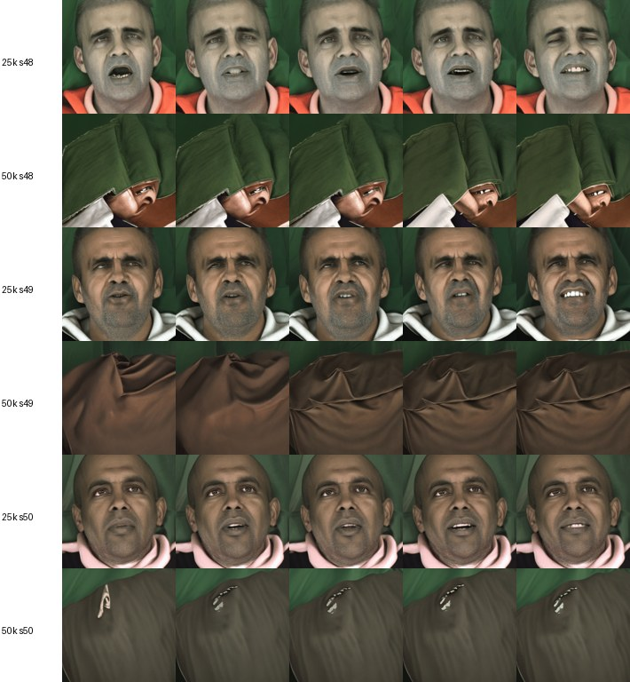

# Longer training: results (November 14, 2026)

Results of the design pre-registered in [2026-10-29 longer-training design](2026-10-29-longer-training-design.md). That entry defines the runs, the readings and their thresholds. The thresholds were not changed after the results.

## Runs

- **Training, 50k.** The job listed in the design (752058) failed. It landed on sdumont2nd2047, whose GPU reported "NVML: GPU requires reset"; DDP then stopped with "rank 0 has inconsistent 0 params", and the job hung until its 6 h limit without writing a checkpoint.
  - It was resubmitted unchanged as **766141** with `--exclude=sdumont2nd2047`: 50k steps in 3 h 50 on sdumont2nd2060. The LR reached 0 at step 50k, and 10 main + 10 EMA checkpoints were written, every 5k.
  - The failed run's directory (`output/lowend/treat50k/expression_lowend_treat_50k.local-2026-10-29T21-47-41`, no checkpoints) is left in place.
- **Training, replicate.** Job 752059 completed 25k steps in 1 h 59.
- **Same data and noise, verified.** The design expected the 50k run to see the reference run's data and noise for its first 25k steps, but had not checked it. The logged loss (rank 0, every 50 steps) of the 50k run and of the reference correlates at r = 1.000 in each 5k block of the first 25k steps; the values differ only in the fourth decimal (e.g. 0.0449 vs 0.0448 at step 100). The replicate against the reference gives r between −0.09 and +0.22.
- **Evaluation.**
  - Reference 25k: job 752060.
  - 50k: job 766143, chained to the training with `--dependency=afterok`.
  - Replicate: job 766142 completed `scaled` and `permuted`. Its `calibration_jitter` stopped at start because GPU 0 of sdumont2nd2056 was "busy or unavailable"; the launcher's CUDA check caught it. `calibration_jitter` alone was rerun as job 766741 (1 GPU, excluding nodes 2047 and 2056) into the same output directory.
  - All three models: 990 / 120 / 270 records for `calibration_jitter` / `scaled` / `permuted`, no tracebacks other than the one from the failed start.
- **Analysis.** Files are in `inference_output/batch_eval/fresh/longer_analysis/`.
  - `longer_analysis.py` holds the pre-registered readings. It is the copy saved on October 29, before any result. Printed output: `longer_analysis.out`; report: `inference_output/batch_eval/fresh/longer_report.json`.
  - `longer_posthoc.py` holds the follow-ups marked *not pre-registered* below. Output: `longer_posthoc.out` and `inference_output/batch_eval/fresh/longer_posthoc.json`.
  - `longer_sheet.py` builds the contact sheets `longer_c0.jpg` and `longer_ramps.jpg`; `longer_p31_ramps.jpg` is the figure below.
- **Statistics.** All Δ are paired, with a 2,000-draw bootstrap over (prompt, seed) units. "Fail", "frame 0" and "c ≤ 0.1" are defined as in [2026-10-29](2026-10-29-low-end-retrain-results.md).

## Primary: 50k − 25k (seed 42), fresh units

The last column is the replicate (seed 142 − seed 42, both 25k) on the same units: the run-to-run yardstick.

| protocol | metric | 25k | 50k | Δ 50k − 25k [95% CI] | replicate Δ [95% CI] |
|---|---|---|---|---|---|
| calibration_jitter (90 units) | CLS MediaPipe | 0.492 | 0.497 | **+0.005 [−0.044, +0.058]** | −0.005 [−0.040, +0.031] |
| | CLS py-feat | 0.606 | 0.678 | +0.073 [+0.021, +0.123] | +0.001 [−0.045, +0.043] |
| | c ≤ 0.1 MediaPipe | −0.002 | −0.011 | −0.009 [−0.011, −0.007] | −0.001 [−0.002, +0.001] |
| | c ≤ 0.1 py-feat | 0.341 | 0.271 | −0.070 [−0.110, −0.031] | +0.002 [−0.026, +0.033] |
| scaled (120 units) | frame 0 MediaPipe | −0.007 | −0.015 | −0.008 [−0.010, −0.005] | +0.001 [−0.000, +0.003] |
| | frame 0 py-feat | 0.289 | 0.231 | −0.059 [−0.097, −0.020] | +0.020 [−0.015, +0.056] |
| | ramp MediaPipe r | 0.808 | 0.888\* | **+0.067 [+0.026, +0.110]** | +0.011 [−0.024, +0.047] |
| | ramp AU12 r | 0.804 | 0.832\* | +0.026 [−0.007, +0.058] | −0.032 [−0.073, +0.006] |
| | fail | 6.7% | 2.5%\* | −4.2 pt [−9.2, +0.8] | −0.8 pt [−5.8, +4.2] |
| | id min-adjacent | 0.868 | 0.880 | **+0.014 [−0.001, +0.028]** | +0.002 [−0.012, +0.015] |
| permuted (90 units) | AU12 r | 0.727 | 0.763 | **+0.037 [−0.008, +0.078]** | −0.012 [−0.050, +0.023] |
| | MediaPipe r | 0.746 | 0.807 | **+0.051 [+0.008, +0.094]** | +0.033 [−0.005, +0.068] |
| | id min-adjacent | 0.881 | 0.888 | +0.009 [−0.001, +0.018] | +0.008 [+0.001, +0.016] |

\* These 50k values leave out its three no-face ramps (next section), whose r is undefined. The Δ is taken over units where both models have a value. `fail()` counts an undefined r as a pass.

**Readings:**

1. **Calibration: fails.** The CLS MediaPipe Δ is +0.005, and its CI [−0.044, +0.058] includes 0. The point estimate exceeds the replicate's |Δ| only in the fourth decimal (0.0054 vs 0.0048), so both are noise-sized.
2. **Guardrails: all hold** (point estimates against thresholds):
   - ramp MediaPipe r +0.067 (≥ −0.05);
   - permuted AU12 r +0.037 and MediaPipe r +0.051 (≥ −0.05);
   - ramp worst-case adjacent identity +0.014 (≥ −0.02). The identity drop seen over the 25k run did not continue.

**Decision rule (from the design):** reading 1 fails, so the 25k stays the main model. MediaPipe calibration has plateaued for this recipe, and the next lever is not training length.

## A failure the readings do not see: prompt 31 (not pre-registered)

The contact sheet of c = 0 frames showed a 50k tile with no face. Counting records where MediaPipe finds no face in any frame:

| model | calibration_jitter | scaled | permuted |
|---|---|---|---|
| 25k (seed 42) | 0 / 990 | 0 / 120 | 0 / 270 |
| 25k (seed 142) | 0 / 990 | 0 / 120 | 0 / 270 |
| 50k | 19 / 990 | 3 / 120 | 7 / 270 |

All of them are prompt 31, "A portrait photograph of a man with an angular jaw, frontal view, neutral background.", across all three seeds. Two more permuted records of that prompt lose the face in some frames. No other prompt is affected in any model.

The 50k fills the frame with a draped cloth matching the green and brown MEAD studio backdrop, with at most a mouth visible. The 25k generates ordinary faces on the same units:

**How the statistics treat these frames:**
- MediaPipe returns NaN for them, and the statistics drop them.
- py-feat returns **0.0** for a frame without a face: `detect_au12` maps a missing face, a non-finite value or an exception to 0.0. These zeros enter the py-feat statistics. Dropping prompt 31 raises the 50k's py-feat mean at each calibration level by 0.006 (c = 0) to 0.021 (c = 0.9).
- `fail()` counts a ramp with undefined r as a pass. With the three no-face ramps counted as failures, the fail rates are 6.7% (25k), 5.8% (seed 142) and 5.0% (50k), instead of 2.5% for the 50k.

**Sensitivity without prompt 31** (all arms; 87 units, 117 ramps): the conclusions do not change.
- CLS MediaPipe Δ +0.008 [−0.047, +0.060] against a replicate Δ of +0.002, so reading 1 still fails.
- CLS py-feat +0.095 [+0.050, +0.141].
- Ramp MediaPipe r +0.067 [+0.025, +0.111]; permuted MediaPipe r +0.058 [+0.016, +0.099].
- c ≤ 0.1 py-feat −0.057 [−0.092, −0.021]; frame 0 py-feat −0.048 [−0.084, −0.010].

A collapse onto the training backdrop on one prompt in 40 is consistent with the longer run pulling generations toward the MEAD scenes. Two things were not tested: whether it occurs on other prompts at other seeds, and whether it is present at the intermediate 50k checkpoints.

## What longer training changes (not pre-registered)

Mean detected level by commanded level, `calibration_jitter`, fresh units. The 50k's py-feat row includes the prompt-31 zeros.

| py-feat AU12 | 0.0 | 0.1 | 0.2 | 0.3 | 0.4 | 0.5 | 0.6 | 0.7 | 0.8 | 0.9 | 1.0 | 1.0 − 0.0 |
|---|---|---|---|---|---|---|---|---|---|---|---|---|
| 25k, seed 42 | 0.333 | 0.349 | 0.383 | 0.413 | 0.463 | 0.498 | 0.569 | 0.599 | 0.683 | 0.797 | 0.874 | 0.541 |
| 25k, seed 142 | 0.334 | 0.354 | 0.401 | 0.442 | 0.479 | 0.504 | 0.564 | 0.615 | 0.708 | 0.814 | 0.894 | 0.560 |
| 50k | 0.258 | 0.284 | 0.328 | 0.369 | 0.429 | 0.483 | 0.560 | 0.624 | 0.708 | 0.808 | 0.895 | 0.637 |

| MediaPipe | 0.0 | 0.1 | 0.2 | 0.3 | 0.4 | 0.5 | 0.6 | 0.7 | 0.8 | 0.9 | 1.0 | 1.0 − 0.0 |
|---|---|---|---|---|---|---|---|---|---|---|---|---|
| 25k, seed 42 | −0.002 | −0.002 | 0.001 | 0.002 | 0.004 | 0.006 | 0.010 | 0.012 | 0.017 | 0.022 | 0.029 | 0.030 |
| 25k, seed 142 | −0.002 | −0.003 | 0.001 | 0.002 | 0.004 | 0.007 | 0.010 | 0.012 | 0.017 | 0.023 | 0.030 | 0.033 |
| 50k | −0.012 | −0.011 | −0.008 | −0.006 | −0.003 | −0.001 | 0.002 | 0.005 | 0.007 | 0.014 | 0.024 | 0.036 |

- **The 50k lowers the bottom half of the scale on both detectors** and leaves the top roughly where it was. The range widens: py-feat 0.54 → 0.64, MediaPipe 0.030 → 0.036.
- **Why CLS MediaPipe does not follow.** Without prompt 31, the between-level spread of MediaPipe grows by about 10% (SD 0.0096 → 0.0106), but the mean within-level spread grows almost as much (0.0161 → 0.0173). Their ratio moves only from 0.60 to 0.61, so the pooled correlation stays at ~0.50.
- **Gains beyond the replicate on secondary metrics:** ramp MediaPipe r (+0.067 vs +0.011), CLS py-feat (+0.073 vs +0.001), and the low end on both detectors. Permuted MediaPipe r (+0.051) is closer to the replicate's +0.033. The py-feat gains share the detector with the training labels (circularity caveat in `status.md`).
- **The low end now sits below the neutral references.** The 50k's c = 0 reads 0.26 on py-feat, against 0.32 for real MEAD neutral faces. On MediaPipe it reads −0.012, below the floor the earlier models sat at (about −0.005 to +0.001).
  - In the c = 0 contact sheet (12 random units), the 50k's frames look neutral or slightly open-mouthed, and 2 of 12 show pursed lips (p22 s50, p34 s50). None shows an obvious frown.
  - The detectors cannot say whether "below neutral" is a more neutral face or a different mouth shape.

## Replicate: run-to-run noise (pre-registered, descriptive)

- **Seed 142 vs seed 42 at 25k.** Every Δ CI includes 0 except permuted identity (+0.008 [+0.001, +0.016]). CLS moves by ≤ 0.005, and ramp and permuted r by ≤ 0.04.
- **Run-to-run variation is small** next to the 2026-10-29 treatment − control effects (+0.13 to +0.15), so those effects are not a lucky seed. This is one replicate, i.e. one draw of the run-to-run distribution.
- **The main model's numbers carry over from the held-out units to these fresh ones:**

| metric | held-out (2026-10-29) | fresh |
|---|---|---|
| CLS py-feat / MediaPipe | 0.62 / 0.48 | 0.61 / 0.49 |
| ramp AU12 r / MediaPipe r | 0.81 / 0.84 | 0.80 / 0.81 |
| permuted AU12 r / MediaPipe r | 0.67 / 0.73 | 0.73 / 0.75 |
| fail | 6.7% | 6.7% |

## Conclusions

1. **Pre-registered result.** Training the recipe to 50k does not raise MediaPipe calibration: Δ +0.005, the size of the replicate gap. The 25k EMA stays the main model. Following the design, the next calibration lever is not training length but something like a magnitude-aware CCL, or data.
2. **The 50k is not uniformly better or worse.** It improves ramp MediaPipe r and py-feat calibration beyond the replicate, and lowers the low end. It also collapses one prompt onto the training backdrop, and the pre-registered metrics drop that failure rather than penalize it. Even if reading 1 had held, adopting the 50k would have required checking this failure first.
3. **The 2026-10-29 results are robust to the training seed.**
4. **Evaluation gap.** No-face outputs are scored rather than flagged: py-feat scores them 0.0, and `fail()` counts them as passes. Analyses should report the no-face rate as a metric of its own.

**Open items:**
- Whether an intermediate checkpoint (EMA 30k–45k, on disk) keeps the ramp gain without the collapse. This would need its own pre-registration on new units.
- A no-face count in `batch_eval.py summarize` / `compare_eval.py`.
